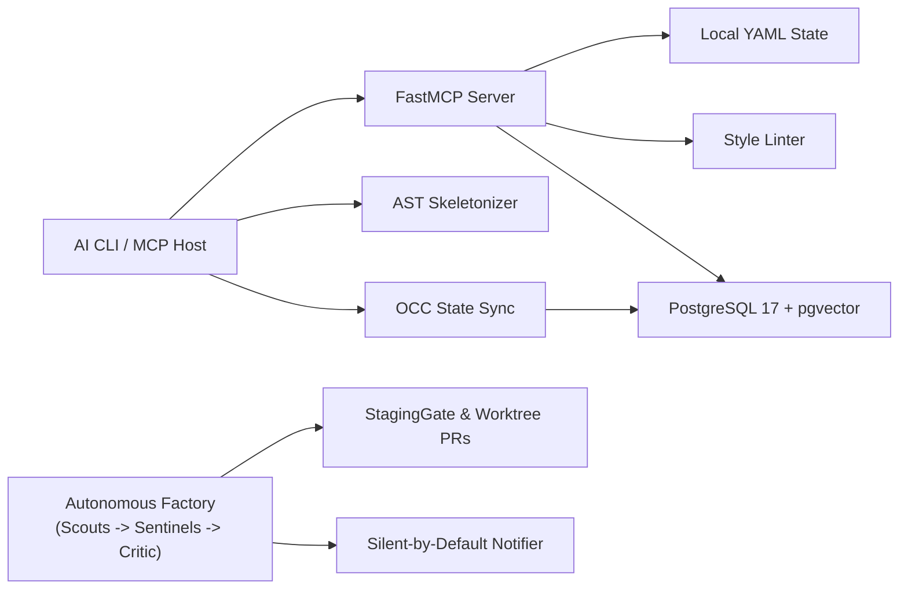

# personal-os-starter

Minimal, self-contained starter kit for a local-first AI memory engine, FastMCP control plane, symbolic AST repo mapper, and 3-layer autonomous operations pipeline backed by PostgreSQL 17 (`pgvector`) and YAML state files.

Prompt rules alone are unreliable for enforcing hard limits on weekly workload, spending gates, prompt-injection isolation, or state concurrency. This repo moves those checks into deterministic Python and PostgreSQL so an agent host cannot bypass them.

## What is included



- `src/mcp_server.py` — FastMCP stdio server exposing 7 tools: `query_hybrid_memory`, `ingest_micro_card`, `get_active_facts`, `log_decision_mirror`, `verify_capacity_slack`, `edit_capacity_allocation`, and `check_runway_gate`.
- `src/skeletonizer.py` — Zero-dependency Python AST & TypeScript signature skeletonizer (`< 25 ms` per module) to prevent context rot without stuffing whole files into prompts.
- `src/db/supabase_repo.py` — PostgreSQL/Supabase wrapper with SHA-256 deduplication before embedding calls and Reciprocal Rank Fusion (RRF) search.
- `src/state_sync.py` — Optimistic Concurrency Control (OCC) state synchronizer (`FOR UPDATE` version check in SQL so stale writes fail instead of clobbering newer state).
- `src/autonomous/` — 3-layer scheduled intelligence & operations factory:
  - `scouts.py` + `src/security/sanitizer.py` — Read-only RSS/Atom ingestion with 1 MB cap, XXE/DTD rejection, OWASP IPI filtering, recency/prerelease/release-cap guards, and ephemeral cryptographic nonce delimiters.
  - `sentinels.py` — Deterministic local watchers (`S1` state readiness, `S2` financial runway/Kingman capacity/staleness, `S4` AST + `pytest` self-health).
  - `critic.py` + `src/telegram_notifier.py` — Deterministic Confidentiality & PII Scope Filter, hardware guardrails, Silent-by-Default STE-180 (Simplified Technical Express — <=180 words signal-to-action brief) formatting, and `fcntl.flock` rate-capped outbound alerts.
  - `staging_gate.py` + `agy_bridge.py` — Isolated `git worktree` Draft PR pipeline enforcing Carbon/Neon orchestration (`ValueError` on `flash`/`flash_lite` delegation), forbidden-path locks, and fail-silent rollback.
- `src/drive_client.py` — Sanitized Google Drive artifact uploader (with path-traversal-safe filename sanitization) and pure-Python Gemini public share link RPC decoder.
- `src/stylistics/naturalizer.py` — Zero-LLM technical style linter scrubbing verbose boilerplate phrasing and measuring sentence-length variance (`CV`) and Type-Token Ratio.
- `supabase/migrations/` — SQL migrations defining `knowledge_cards` (`halfvec(768)` HNSW + multilingual `'simple'` GIN FTS + `match_knowledge_hybrid`), `executive_state` (OCC upsert), and `user_facts` (JSONB history on contradiction).
- `scripts/audit_public.py` — Zero-dependency scanner that checks for secrets, blocked paths, and custom private markers before publishing.

## Design notes

- **Half-precision vector indexing (`halfvec(768)`):** Storing 16-bit floats cuts HNSW memory usage in half (`1,536` vs. `3,072 bytes/row`) while blending semantic and full-text rank via Reciprocal Rank Fusion (`k = 50`, `w_vec = 1.5`, `w_fts = 1.0`).
- **Kingman queuing capacity guard:** Expected queuing delay grows with `rho / (1 - rho)`. `verify_capacity_slack` and `edit_capacity_allocation` enforce `rho <= 0.75` for off-hours personal study & open-source R&D (`12.0h–21.0h/week` configurable spare-time budget; `15.0h` cap out of a `20.0h` evening/weekend pool in `state.example/`, keeping `5.0h` slack) and return `HARD_BLOCK` without modifying `state/current_priorities.yaml` on overflow.
- **Orchestration & anti-sycophancy discipline:** See [AGENTS.example.md](AGENTS.example.md) and [docs/ARCHITECTURE.md](docs/ARCHITECTURE.md) for the Carbon orchestrator / Neon worker policy lock and closed-laptop serverless webhook architecture.

## Quickstart

```bash
git clone https://github.com/Giorgoskokk06/personal-os-starter.git
cd personal-os-starter

python3 -m venv .venv
source .venv/bin/activate
pip install -r requirements.txt

cp -r state.example state
cp .env.example .env

pytest -v
python3 scripts/audit_public.py
```

Try the AST skeletonizer and offline autonomous factory smoke run (zero network I/O):

```bash
python3 -m src.skeletonizer src --budget 1200 --markdown
python3 -m src.autonomous.cli --job sat-digest --offline --dry-run --json
```

Run the MCP server over stdio:

```bash
python3 src/mcp_server.py
```

### Database migrations

Apply the three SQL files in order on PostgreSQL 17 with `pgvector >= 0.7.0`:

```text
supabase/migrations/20261016000001_hybrid_rag_schema.sql
supabase/migrations/20261029000000_executive_state.sql
supabase/migrations/20261102000000_user_facts.sql
```

## Repository layout

```text
docs/ARCHITECTURE.md         # System design, Carbon/Neon policy & Edge webhook pattern
AGENTS.example.md            # Sanitized multi-agent orchestration & guardrail template
src/
  mcp_server.py              # FastMCP server (7 tools)
  skeletonizer.py            # Sub-25ms Python AST & TypeScript repo-map generator
  state_sync.py              # OCC state sync & HUD builder
  telegram_notifier.py       # Outbound-only flock-guarded Telegram notifier
  drive_client.py            # Optional Drive upload & share-link RPC decoder
  autonomous/                # 3-layer Scouts -> Sentinels -> Critic + Draft PR Factory
  security/sanitizer.py      # HTML/BiDi normalization, OWASP IPI filter & nonce wrapping
  db/supabase_repo.py        # Hybrid RRF retrieval & SHA-256 dedup
  stylistics/naturalizer.py  # Deterministic style & cadence linter
state.example/               # Synthetic YAML/Markdown templates & autonomous policy
supabase/migrations/         # pgvector halfvec(768), OCC, and user_facts SQL
scripts/audit_public.py      # Pre-publish secret & marker scanner
tests/                       # Offline-safe unit & red-team IPI test suite
```

## License

[MIT](LICENSE)
