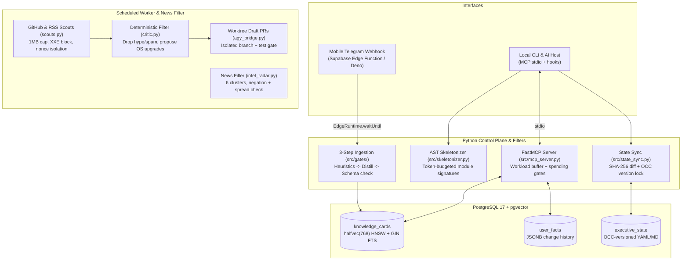

# Architecture Overview

This starter kit implements a local-first, Postgres-backed AI memory and scheduled automation system built around four practical engineering problems: context bloat, prompt rules getting ignored under load, duplicate API embedding cost, and concurrent state overwrites.

## 1. Database Layout and Hybrid Search

* **Half-precision vector indexing (`supabase/migrations/20261016000001_hybrid_rag_schema.sql`):** `public.knowledge_cards` stores 16-bit `halfvec(768)` embeddings instead of 32-bit `vector(768)`, cutting HNSW index memory roughly in half (`1,536` vs `3,072 bytes/row`). The `match_knowledge_hybrid` SQL function blends cosine similarity and `'simple'` GIN full-text search via Reciprocal Rank Fusion (`k = 50`, `full_text_weight = 1.0`, `semantic_weight = 1.5`).
* **Pre-embedding deduplication (`src/db/supabase_repo.py`, `src/mcp_server.py`):** `ingest_micro_card` computes a SHA-256 `thread_hash` and checks PostgreSQL before calling any embedding API.
* **Evolving facts (`supabase/migrations/20261102000000_user_facts.sql`):** Updating an existing fact key appends the previous value and timestamp to a JSONB `history[]` array rather than overwriting history.
* **Optimistic Concurrency Control (`src/state_sync.py`, `supabase/migrations/20261029000000_executive_state.sql`):** `upsert_executive_state_occ` locks the target row with `SELECT ... FOR UPDATE` and rejects writes when `expected_version` is stale, saving a local conflict backup instead of clobbering newer remote edits.

## 2. 3-Step Memory Ingestion Pipeline (`src/gates/`)

1. **Gate 1 (`gate1_heuristics.py`):** Zero-LLM filter that drops greetings, unit conversions, prompts under 40 characters, secret leaks (`ghp_`, `AKIA`, `sk-`, private keys), and already-ingested thread hashes.
2. **Gate 2 (`gate2_llm_distiller.py`):** Formats multi-turn threads under a hard character budget using middle-out truncation (keeping metadata, the opening turn, and the final two turns), then extracts a structured `DistilledCard` across generic domains (`systems`, `backend`, `security`, `operations`, `research`, `general`) with a deterministic local fallback.
3. **Gate 3 (`gate3_validator.py`):** Enforces Pydantic schema constraints (`value_score >= 6`, `distilled_summary >= 80 chars`, valid domain/intent enums, 768-dim embedding length) and checks hash deduplication before insert.

## 3. Workload, Budget, and AST Context Guards

* **Workload & spending limits (`src/mcp_server.py`):** `verify_capacity_slack` and `edit_capacity_allocation` keep weekly side-project utilization at `rho <= 0.75` (retaining a 25% slack buffer so tasks do not queue up) and return `HARD_BLOCK` without editing YAML on overflow. `check_runway_gate` blocks non-essential hardware expenses until liquid reserves meet the target threshold.
* **AST code skeletonizer (`src/skeletonizer.py`):** Parses Python modules via stdlib `ast` and TypeScript interfaces via regex in under `25 ms`, emitting compact signatures within a configurable `--budget` so coding agents do not burn context reading full source files.

## 4. Scheduled Background Worker (`src/autonomous/`, `systemd/`)

Portable `systemd --user` timers (`scripts/setup_autonomous_timers.sh`) schedule five jobs:

1. **GitHub & RSS Discovery (`scouts.py`, `src/security/sanitizer.py`):** Queries the GitHub Search REST API (`https://api.github.com/search/repositories`) and RSS/Atom feeds with a `1 MB` payload cap, XML `<!DOCTYPE` / `<!ENTITY` rejection, NFKC + BiDi control-character stripping, prompt-injection regex filtering, and ephemeral hexadecimal nonce wrapping (`<UNTRUSTED_TELEMETRY_PAYLOAD_NONCE_...>`).
2. **Deterministic Noise Filter (`critic.py`):** Drops prompt injections, confidential scope terms, archived/forked repos, below-threshold star counts, incompatible licenses, and awesome-list/tutorial spam. High-signal engineering repositories are promoted to `OS_UPGRADE_CANDIDATE` with a target module and integration note.
3. **Local Watchers (`sentinels.py`):** Checks local state readiness (`S1`), runway gap / workload slack / calibration freshness (`S2`), and AST + `pytest` repo health (`S4`).
4. **Quiet-by-Default Alerts & Isolated Draft PRs (`telegram_notifier.py`, `staging_gate.py`, `agy_bridge.py`):** Sends concise Telegram alerts (`<= 180 words`) only when thresholds trigger (`fcntl.flock` ledger, 24h SHA-256 deduplication, daily rate cap). Code upgrades run inside an isolated `git worktree` on `autonomous/draft-*`, block edits to `AGENTS.md`, `src/mcp_server.py`, `.agents/`, and `supabase/migrations/`, run `pytest -v` + `audit_public.py`, and never auto-merge to `main`.

## 5. News & Macro Signal Filter (`src/intel_radar.py`)

Fetches six global news and market clusters in parallel (`ThreadPoolExecutor` with per-feed timeouts, 1 MB cap, and XXE rejection):

* **Negation & Acronym Handling:** Negators (`"no"`, `"rules out"`, `"denies"`) and de-escalation phrases (`"ceasefire talks"`, `"de-escalation"`) reduce panic scores, while standard acronyms (`ECB`, `OPEC`, `TSMC`, `LNG`) are exempt from all-caps penalties.
* **4-Tier Classification:** Separates headlines into `NOISE_CLICKBAIT`, `CONTROLLED_TENSION`, `HIGH_SIGNAL_STRUCTURAL`, and `CRITICAL_ESCALATION`, pairing text analysis with market checks (10Y bond spreads, Brent crude, Dutch TTF gas).
* **Honest Attribution:** Labels every headline `[LIVE <date>]` or `[ARCHIVE FALLBACK - not current news]` and tags state-aligned media explicitly as official posture rather than verified fact.

## 6. Serverless Telegram Webhook (`supabase/functions/`)

For quick mobile capture away from a terminal, `supabase/functions/telegram/index.ts` runs a `grammY` webhook on Deno:

* Pre-caches `botInfo` to eliminate the cold-start `getMe` HTTP roundtrip.
* Validates `x-telegram-bot-api-secret-token` and restricts updates to `TELEGRAM_ALLOWED_USER_ID`.
* Handles `/remember`, `/search`, `/radar`, `/status`, and `/help`, scanning for accidental secret leaks and running background `knowledge_cards` writes via `EdgeRuntime.waitUntil()`.
