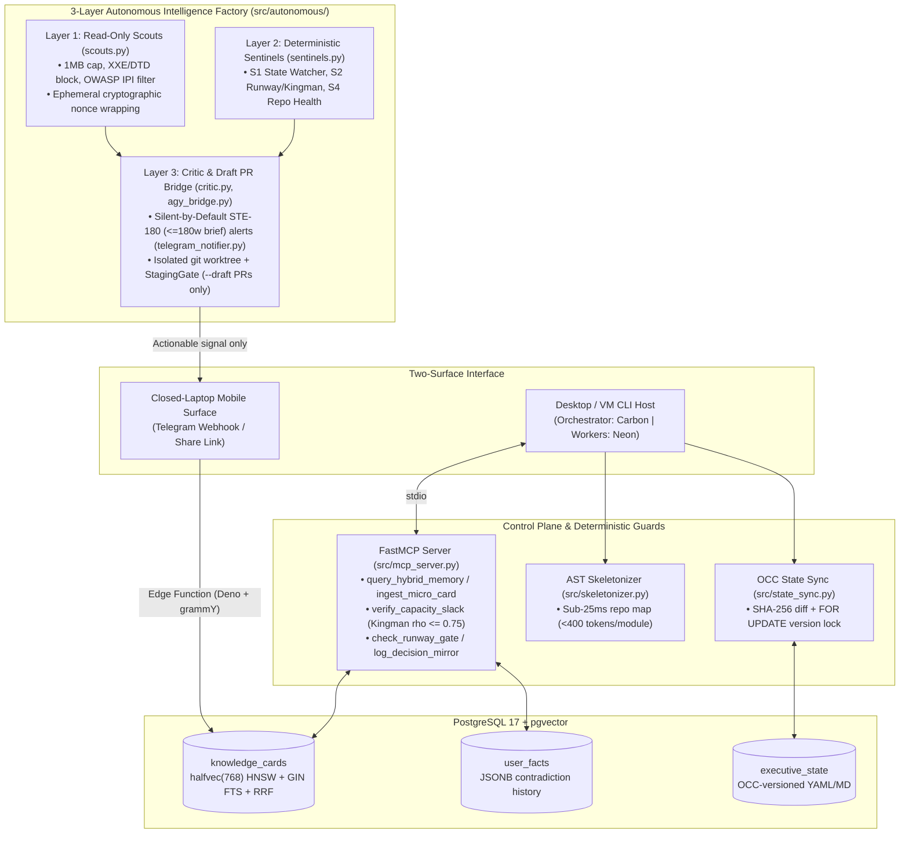

# Architecture Overview

This starter kit implements a **local-first, cloud-synced agentic engineering OS** designed around four reliability problems that standard LLM chat workflows fail to solve: context rot, sycophancy, token waste, and silent state drift.

---

## 1. Multi-Agent Orchestration & Context Discipline

* **Orchestrator vs. Worker Separation (`AGENTS.example.md`):** The root session runs as a lightweight coordinator (`gemini-4-carbon-medium` / `high`) while bulk file inspection, debugging, and test loops are delegated to isolated workers (`gemini-4-neon-medium` / `high`). Low-tier `flash` / `flash_lite` worker delegation is explicitly blocked (`build_agy_headless_cmd` raises `ValueError` if any `flash` model string is passed).
* **Symbolic AST Skeletonizer (`src/skeletonizer.py`):** Instead of stuffing full source files into prompts, agents map modules via Python's stdlib `ast` (`PythonSkeletonizer`) and regex TypeScript extraction (`TypeScriptSkeletonizer`) under a configurable token budget (`--budget 1500`) in `< 25 ms`.

## 2. Hybrid Memory, Evolving Facts & OCC State Sync

* **Half-Precision RRF Retrieval (`supabase/migrations/20261016000001_hybrid_rag_schema.sql`, `src/db/supabase_repo.py`):** Stores `halfvec(768)` embeddings (16-bit floats, cutting HNSW memory footprint in half) alongside a bilingual `'simple'` `tsvector` GIN index, combined via Reciprocal Rank Fusion (`match_knowledge_hybrid`, `k = 50`, `w_vec = 1.5`, `w_fts = 1.0`).
* **Pre-Embedding Deduplication:** `ingest_micro_card` checks SHA-256 `thread_hash` in PostgreSQL before calling any embedding endpoint, eliminating duplicate API calls and scrubbing boilerplate phrasing via `src/stylistics/naturalizer.py`.
* **Evolving Fact Layer (`supabase/migrations/20261102000000_user_facts.sql`):** Contradictory updates append prior values and timestamps to a `history[]` JSONB array instead of silently overwriting history.
* **Optimistic Concurrency Control (`src/state_sync.py`):** Local YAML/Markdown files (`state/`) synchronize with `public.executive_state` through `upsert_executive_state_occ` (`SELECT ... FOR UPDATE` version check), backing up conflicting local edits instead of clobbering newer remote state.

## 3. Neuro-Symbolic Hard Guards (`src/mcp_server.py`)

Prompt instructions alone yield when a sprint gets busy. Deterministic gates live in Python behind FastMCP tools:

* **Kingman Capacity Guard (`verify_capacity_slack`, `edit_capacity_allocation`):** Models weekly off-hours personal study & open-source R&D queue delay scaling with $\rho / (1 - \rho)$ and enforces $\rho \le 0.75$ (configurable `12.0h–21.0h/week` spare-time budget; `15.0h` cap out of a `20.0h` evening/weekend pool in `state.example/`), returning `HARD_BLOCK` without mutating `current_priorities.yaml` on overflow.
* **Financial Shield Gate (`check_runway_gate`):** Blocks discretionary capex/hardware categories (`HARD_BLOCK`) until `current_runway_eur >= target_runway_eur`.

## 4. 3-Layer Autonomous Intelligence & Scheduled Ops Factory (`src/autonomous/`)

Designed to run unattended via `systemd` timers on a lightweight Linux host:

1. **Layer 1 — Read-Only Scouts (`src/autonomous/scouts.py`, `src/security/sanitizer.py`):** Fetches RSS/Atom feeds concurrently with a `1 MB` payload cap, strict `<!DOCTYPE` / `<!ENTITY` rejection (XXE defense), HTML/script/BiDi normalization, OWASP Indirect Prompt Injection pattern flagging, recency/prerelease/per-repo release filtering, and ephemeral cryptographic nonce delimiters (`<UNTRUSTED_TELEMETRY_PAYLOAD_NONCE_...>`) separating data from instructions.
2. **Layer 2 — Deterministic Sentinels (`src/autonomous/sentinels.py`):**
   * `S1`: Local workspace state readiness watcher.
   * `S2`: Financial Runway gap, Kingman utilization, and state-calibration staleness monitor.
   * `S4`: Repository health sentinel checking AST skeleton cleanliness and offline `pytest` pass status.
3. **Layer 3 — Deterministic Critic, Silent-by-Default Alerts & Worktree Draft PR Factory (`critic.py`, `telegram_notifier.py`, `staging_gate.py`, `agy_bridge.py`):**
   * `classify_item` drops IPI payloads, Confidentiality & PII Scope Filter matches (`nda_dataset`, `pii_record`, `secret_key_material`, `restricted_contract`), and hardware deals below the financial shield threshold before any LLM sees them.
   * `sanitize_ste180_telegram` enforces **STE-180 (Simplified Technical Express — <=180 words signal-to-action brief)** and **Silent-by-Default** (`SILENT_NO_SIGNAL` or nominal sentinels emit `""` so raw RSS never spams Telegram) and truncates HTML-escaped bullets cleanly at word boundaries.
   * `TelegramNotifier` (`src/telegram_notifier.py`) is strictly outbound-only with `fcntl.flock` ledger locking, 24-hour SHA-256 deduplication, and daily rate capping.
   * `run_agy_draft_pr_factory` validates `StagingGate` (`auto_merge_main == False`, `autonomous/draft-*` branch, weekly cap via `flock`), executes changes in an isolated `git worktree`, blocks forbidden invariant paths (`AGENTS.md`, `src/mcp_server.py`, `.agents/`, `supabase/migrations/`), runs the full verification gate before opening `--draft` PRs, and fails silently to `staging_log.json` on errors.

## 5. Closed-Laptop Serverless Webhook Pattern

For mobile capture when away from the terminal, a lightweight Supabase Edge Function (Deno + `grammY`) verifies the sender allowlist, runs `match_knowledge_hybrid` against the same PostgreSQL tables, dispatches quick status checks deterministically, and schedules background 3-gate micro-ingestion via `EdgeRuntime.waitUntil()`—including pure-Python/TS resolution of shared conversation links (`resolve_gemini_share_url` in `src/drive_client.py`).
